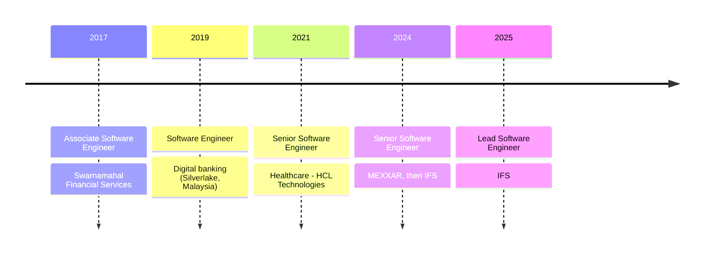

<!-- Header -->
<p align="center">
  
</p>

<p align="center">
  
</p>

<p align="center">
  <a href="https://linkedin.com/in/randika-abeyrathna"></a>
  <a href="mailto:randika.l.abeyrathna@gmail.com"></a>
  
  
</p>

---

## 👨‍💻 About Me

I'm a **Lead Software Engineer** with **8+ years** of experience designing and building enterprise Java backends.
I've shipped software across **aerospace, banking, healthcare and financial services**, and I enjoy the hard parts:
untangling legacy systems, tuning databases, and helping engineers grow — while staying hands-on with the code.

- 🏢 Currently leading a backend team at **IFS**, modernizing legacy Java/JSP modules onto **IFS Cloud (Aurena)**
- 🤖 Exploring **AI in the Java world**: building LLM-powered features with **Spring AI** & **LangChain4j**
- ⚡ I like reading **execution plans** more than most people should
- 🧑‍🏫 I mentor engineers through code reviews, pairing and knowledge sharing
- 🧠 Always sharpening my **Data Structures & Algorithms**
- 🌍 Based in **Colombo, Sri Lanka** 🇱🇰
- 🤝 Open to collaborating on **backend & system design** projects

```java
public class Randika extends SoftwareEngineer {

    String role       = "Lead Software Engineer";
    int    experience = 8; // years, and counting
    String[] domains  = { "Aerospace", "Banking", "Healthcare", "Financial Services" };

    String[] currentFocus = {
        "Enterprise modernization (IFS Cloud / Aurena)",
        "Oracle SQL & PL/SQL performance tuning",
        "Scalable Spring Boot microservices",
        "AI-powered backends with Spring AI",
        "Leading & mentoring engineering teams"
    };

    String funFact = "A query plan with a FULL TABLE SCAN keeps me up at night.";
}
```

---

## 🤖 AI × Backend Engineering

I believe the next wave of enterprise software is **Java backends that can think**. I'm bringing AI into the
Spring ecosystem I know best: same reliability, security and observability, now with LLMs in the loop.

| 🔍 What I'm exploring | 💡 Why it matters |
|---|---|
| **Spring AI** `ChatClient`, prompt templates & structured output | Add LLM features to existing Spring Boot services without leaving Java |
| **RAG** with embeddings & vector stores (**pgvector**) | Let AI answer from real enterprise data, not guesses |
| **Tool / function calling** & **MCP** | Let models safely call existing APIs and business logic |
| **AI-assisted development** (Claude Code, Copilot) | Ship faster and review smarter as a team lead |

```java
@RestController
class AskController {

    private final ChatClient chat;

    AskController(ChatClient.Builder builder) {
        this.chat = builder
            .defaultSystem("You are a helpful assistant for enterprise backend engineers.")
            .build();
    }

    @GetMapping("/ask")
    String ask(@RequestParam String question) {
        return chat.prompt().user(question).call().content();
    }
}
```

---

## 🛠️ Tech Stack

| | |
|---|---|
| **💬 Languages** |   |
| **⚙️ Backend** |        |
| **🗄️ Databases** |    |
| **☁️ Cloud** |        |
| **🤖 AI & LLMs** |         |
| **🚀 DevOps & Tools** |   |
| **🧭 Ways of Working** |     |
| **🧪 Also played with** |  |

---

## 🚀 Career Journey



<details>
<summary><b>🏆 A few things I'm proud of</b> (click to expand)</summary>
<br>

- 🔄 Driving a large-scale **legacy Java/JSP → IFS Cloud Aurena** modernization at IFS
- ⚡ Speeding up enterprise apps by **tuning Oracle SQL**, redesigning views and reading a *lot* of execution plans
- 👥 Leading a **team of 5 backend engineers** and introducing Agile + Jira sprint planning at MEXXAR
- ☁️ Owning **AWS infrastructure and deployment pipelines** for production releases
- 🏦 Building digital banking features for **People's Bank Sri Lanka**
- 🏪 Building a pawning system used across **17 branches** and an HR system for **500+ employees**

</details>

<details>
<summary><b>🎓 Education</b> (click to expand)</summary>
<br>

- **MSc in Information Technology** — Cardiff Metropolitan University · *Distinction*
- **B.Eng. in Software Engineering** — IIC University of Technology · *Second Upper Class*

</details>

---

## 💬 Ask Me About

`Spring Boot microservices` · `Oracle performance tuning` · `Legacy modernization` · `AWS deployments` · `Spring AI & RAG` · `Leading backend teams` · `Code reviews that actually help`

---

## 📊 GitHub Stats

<p align="center">
  
  
</p>

<p align="center">
  
</p>

<p align="center">
  
</p>

---

## 🐍 Contribution Snake

<p align="center">
  <picture>
    <source media="(prefers-color-scheme: dark)" srcset="https://raw.githubusercontent.com/Randika-Lakmal-Abeyrathna/Randika-Lakmal-Abeyrathna/output/github-snake-dark.svg" />
    <source media="(prefers-color-scheme: light)" srcset="https://raw.githubusercontent.com/Randika-Lakmal-Abeyrathna/Randika-Lakmal-Abeyrathna/output/github-snake.svg" />
    
  </picture>
</p>

---

## ✍️ Random Dev Quote

<p align="center">
  
</p>

<!-- Footer -->
<p align="center">
  
</p>
